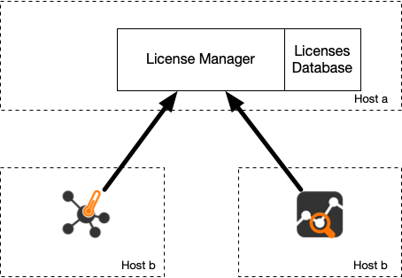

Introduction
============

In addition to standard per-server licenses, it is possible to centralize licenses on a license manager (LM) application that is part of the `ntop-license` package.

The LM is a software application that allos you to deploy your ntop licenses on a central location to which ntop apps will connect to. Differently from 'classic' ntop licenses  that are bound to a host permanent systemId (based on the CPU and MAC address of the management interface), LM licenses are about to the host where the LM runs regardless of the applications (e.g. ntopng) are running.


	    
The main advantages of the license manager are:

- central location for storing licenses of your company: update/distribute licenses from a central location
- cloud-less/on-premise license verification and enforcement
- support for dynamic environments such as Kubernets and containers without the need to bind an application license to the systemId that is constantly changing on virtualized environments

The only constraint of the LM is the need to install the LM on a machine/VM whose systemId is persistent as all licenses are bound to the host where the LM runs, while applications (e.g. ntopng) can move across systems.

Using the License Manager
=========================


The LM needs to be installed on a network host of your LAN that is stable from the systemId standpoint (i.e. installing it on a container is probably not a good idea) meaning that the host and the management NIC of the host where the LM run should not change.

The LM application is installed by the ```ntop-license``` package that runs it as a service. This package is available from a dedicated repository that needs to be enabled with the credentials provided by ntop (see the Installation section). The first thing you need to do is to install your licenses in the LM license directory that is typically /etc/ntop/license_manager. Note that the LM licenses are different from standard licenses, so make sure you ask for/install LM licenses as others will not be recognized. Once the LM is started, it listens on a network for applications willing to validate licenses.

In order to use the LM for validating the license you

- do not need to install a nProbe standard license
- need to install the customer-specific client file /etc/licensemgr.bin provided by ntop on the host running nProbe
- you need to start nProbe adding the following CLI option ```--license-mgr <license manager>.conf```. Example ```nprobe -i eth1 --license-mgr <license manager>.conf```.

If license validation is successfull, nProbe will be permanently connected to the LM meaning that the used license cannot be used by another nProbe application. As soon as the application terminates the licenses can now be used by another nProbe instance eventually running on a different host.

Standard vs License Manager Licenses
====================================

The LM does NOT accept standard ntop licenses but it needs special licenses you can request to ntopng. A LM license is:

- Bound to the LM systemId (and not bound to the systemId of the applications using it)
- Able to license multiple applications: currently you can license up to 32768 host with a single LM license.  For instance you can install a LM license able to license 25 nProbes with a single license.
  
The main difference between standard licenses and LM licenses are:

- Standard licenses are bound to a specific host making impossible to use the license on a host other than the one for which the license was generated. With the LM licenses are bound to the host where the LM runs (that's why its systemId should not change) that distributes them to ntop applications regardless of where they run.
- The LM allows to centralize licenses on a single place simplifying maintenance and license updates.
- If ntop applications are unable to communicate with the LM (e.g. lack of connectivity) the ntop application (e.g. nProbe) will try to reconnect a few times, an in case of failure it will terminate the application. This mean that you should use the LM only if you are confident that your network is not affected by connectivity problems.
- The LM allows you to share licenses acros multiple hosts. This means that (not simultaneously) you can use nProbe on host A and host B, thing that was not possible with standard licenses.


Containers and VMs
==================

As the LM is installed on a host with a stable systemId, you can safely deploy your ntop applications (e.g. ntopng and nProbe) on containers and VMs **as long** as they can contact the LM for validating the license.
